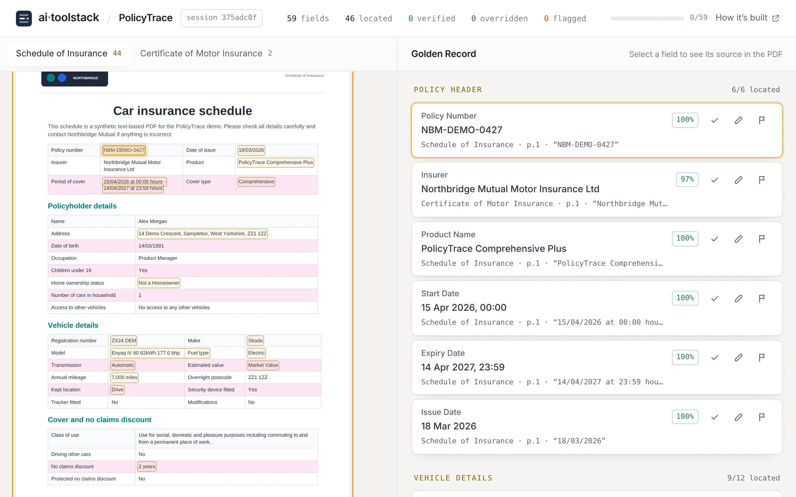
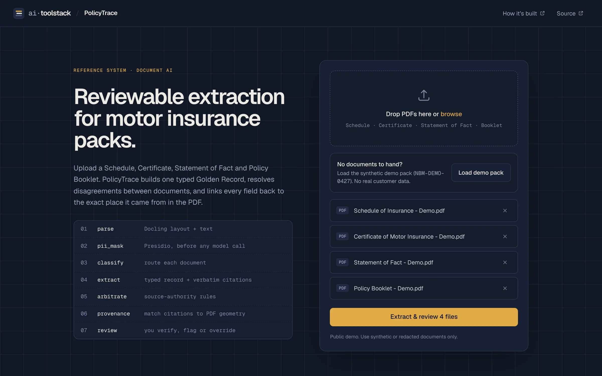
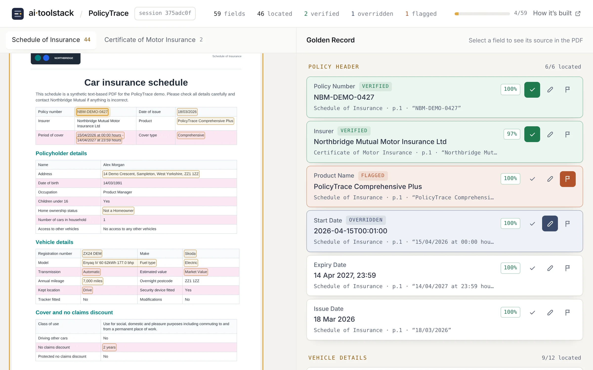
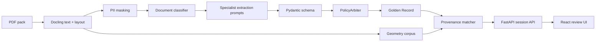

# PolicyTrace



**PolicyTrace is a Document AI workflow for UK motor insurance PDFs.** It extracts a structured Golden Record, resolves fields across multiple policy documents, and gives reviewers source-level evidence inside a split-screen PDF audit UI.

[](https://www.python.org/)
[](https://fastapi.tiangolo.com/)
[](https://react.dev/)
[](Dockerfile)
[](LICENSE)

PolicyTrace is a reference system from [ai·toolstack](https://www.ai-toolstack.com/projects/policytrace/), where each chapter of its design is written up: architecture, source authority, evidence, evaluation and honest limits.

**Live demo:** [Hugging Face Space](https://huggingface.co/spaces/AItoolstack/AI-PolicyTrace) (first load can take about a minute while it wakes up).

## Why This Project Exists

Most AI document demos stop at "the model returned JSON once." Real document workflows need more:

- PDF parsing that survives real layouts.
- Typed outputs that downstream systems can trust.
- PII handling before model calls.
- Multi-document source authority rules.
- Conflict detection.
- Field-level evidence.
- A human review loop.

PolicyTrace shows that full path using a realistic UK motor insurance pack.

## Demo

The repo includes a fully synthetic demo pack, safe for public screenshots and deployments:

```text
sample_data/policytrace_demo_pack/
```



Upload the demo PDFs, then inspect and verify extracted fields:



## What It Does

- Upload Schedule, Certificate, Statement of Fact, and Policy Booklet PDFs.
- Convert PDF text and layout with Docling.
- Mask configured PII entities before LLM extraction.
- Classify document type.
- Extract typed JSON with Groq, Instructor, and Pydantic.
- Merge fields using a "hierarchy of truth" policy arbiter.
- Match extracted fields back to source PDF locations.
- Review each field with verify, flag, and override actions.

## Architecture



See [docs/architecture.md](docs/architecture.md) for the detailed walkthrough.

## Tech Stack

| Layer | Tools |
| --- | --- |
| PDF parsing | Docling |
| Extraction | Groq, Instructor, Pydantic |
| PII masking | Microsoft Presidio, spaCy |
| Arbitration | Custom hierarchy-of-truth merge logic |
| Provenance | Docling geometry + fuzzy matching |
| API | FastAPI |
| UI | React, Vite, Tailwind, react-pdf, Zustand |
| Deployment | Docker, Hugging Face Spaces-compatible |

## Repository Layout

```text
.
|-- src/                 FastAPI backend, extraction, schema, provenance
|-- ui/                  React review dashboard
|-- config/              Runtime settings and versioned prompts
|-- sample_data/         Synthetic public demo PDFs
|-- scripts/             Demo PDF generation utilities
|-- tests/               Deterministic unit tests
|-- docs/                Architecture and deployment notes
|-- Dockerfile           Single-container production build
|-- .env.example         Local environment template
`-- README.md
```

## Quickstart

### 1. Backend

```powershell
pip install -r requirements.txt
python -m spacy download en_core_web_lg
Copy-Item .env.example .env
```

Add your Groq key to `.env`:

```text
GROQ_API_KEY="replace_with_your_groq_api_key"
```

Start the API:

```powershell
uvicorn api:app --app-dir src --reload --port 8000
```

### 2. Frontend

```powershell
cd ui
npm install
npm run dev
```

Open:

```text
http://localhost:5173
```

Upload the synthetic PDFs from:

```text
sample_data/policytrace_demo_pack/
```

## CLI Mode

Run extraction without the review UI:

```powershell
python src/main.py --input sample_data/policytrace_demo_pack --output output/golden_record.json
```

## Docker

The Dockerfile builds the React UI and serves it from FastAPI:

```powershell
docker build -t policytrace .
docker run --rm -p 7860:7860 --env-file .env policytrace
```

Open:

```text
http://localhost:7860
```

## Hugging Face Deployment

Use a Hugging Face **Docker Space**. Add `GROQ_API_KEY` as a Space Secret and point the Space at this repo.

Deployment notes are in [docs/hugging-face.md](docs/hugging-face.md). The live demo runs at [huggingface.co/spaces/AItoolstack/AI-PolicyTrace](https://huggingface.co/spaces/AItoolstack/AI-PolicyTrace).

## Tests

```powershell
pip install -r requirements-dev.txt
pytest tests/test_arbiter.py -v
```

## Privacy And Safety

This project can process sensitive insurance documents. For public demos:

- Use only synthetic or redacted PDFs.
- Never commit `.env` or API keys.
- Never commit real policy documents.
- Never commit `output/`, session folders, or debug artifacts.
- Rotate any API key that was ever stored locally before publishing.

See [SECURITY.md](SECURITY.md).

## Current Limitations

- Public demo extraction is synchronous and can take 30 to 90 seconds.
- Provenance matching is useful but not a legal-grade guarantee.
- Public deployments should use synthetic/redacted documents unless stronger retention and access controls are added.
- Production use needs authentication, audit logs, monitoring, and storage policy controls.

## License

MIT. See [LICENSE](LICENSE).
