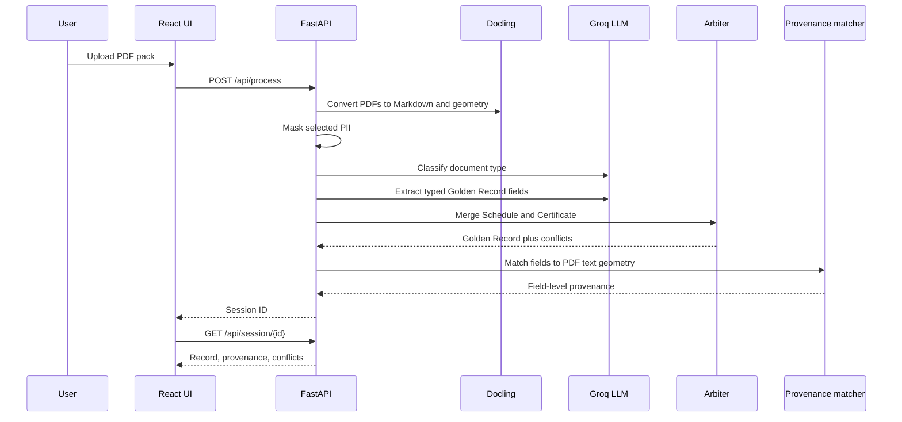

# PolicyTrace Architecture

PolicyTrace is built as a two-part application:

- A Python backend that performs PDF conversion, extraction, arbitration, provenance matching, and session storage.
- A React frontend that lets a human reviewer inspect every extracted field against the source PDF.

## Core Flow

## Backend Modules

### `src/agents.py`

Responsible for document-level work:

- Convert PDF to Markdown using Docling.
- Build a Docling geometry corpus for provenance.
- Mask selected PII before LLM calls.
- Classify document type.
- Route text to specialist extraction prompts.
- Return a `UKMotorGoldenRecord` Pydantic model.

### `src/schema.py`

Defines the canonical output contract:

- `UKMotorGoldenRecord`
- policy header
- vehicle details
- driver details
- cover and excesses
- financial summary
- additional risk data
- field provenance
- conflict entries

The schema keeps most fields optional because each source document is only partially authoritative.

### `src/arbiter.py`

Merges Schedule and Certificate records using a hierarchy of truth.

Schedule wins for:

- vehicle details
- cover type
- no claims discount
- excess breakdown
- financial summary
- driver DOB, occupation, licence type

Certificate wins for:

- class of use
- driving other cars
- legal driver entitlement details when present

When two documents disagree, the arbiter records a `ConflictEntry`.

### `src/provenance.py`

Builds field-level PDF provenance after extraction.

The LLM returns canonical values, such as ISO dates and numeric amounts, but PDF text usually contains raw phrases like `15/04/2026 at 00:00 hours` or `GBP 703.28`.

To bridge that gap, prompts ask the LLM to also provide hidden `field_citations`: verbatim phrases copied from the source document. These citations are excluded from the final serialised record but used for matching against Docling text geometry.

### `src/api.py`

FastAPI service for the review UI:

- `GET /api/health`
- `POST /api/process`
- `GET /api/session/{id}`
- `GET /api/pdf/{session_id}/{filename}`
- `PATCH /api/session/{id}/review`
- `GET /api/session/{id}/review-state`
- `DELETE /api/session/{id}`

When `ui/dist` exists, the API also serves the production React app and supports direct `/session/{id}` refreshes.

## Frontend Modules

### `ui/src/UploadPage.tsx`

Upload screen for PDF packs.

### `ui/src/SessionPage.tsx`

Loads an existing session from the API so sessions can be opened directly from a URL.

### `ui/src/ReviewDashboard.tsx`

Two-column review layout: PDF viewer on the left, Golden Record fields on the right.

### `ui/src/PDFPane.tsx`

Renders PDFs with `react-pdf`, overlays provenance boxes, and scrolls to selected fields.

### `ui/src/RecordPane.tsx` and `ui/src/FieldRow.tsx`

Flatten the nested Golden Record into reviewable field rows with verify, override, and flag actions.

## Why This Architecture

The system deliberately separates concerns:

- The LLM extracts structured values.
- Pydantic validates the shape.
- The arbiter applies domain-specific source authority.
- Provenance is calculated after extraction instead of trusting the model to invent coordinates.
- The UI keeps humans in the loop where confidence, evidence, or conflicts need review.

That separation is what turns the project from a prompt demo into a deployable workflow.
